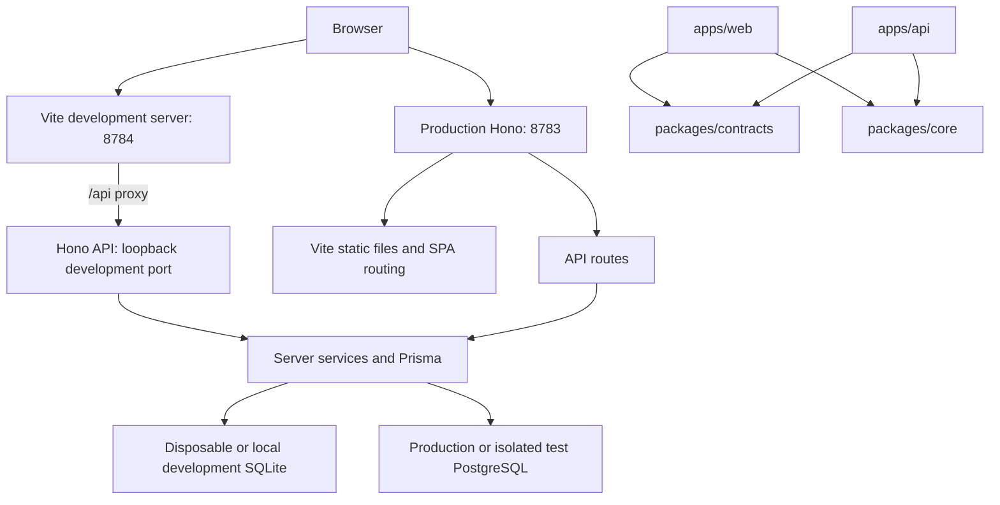

# Hono Monorepo Migration: 00 Overview

## Goal

Convert Fitness to an npm workspaces monorepo with a Vite and React browser app,
a separate Hono backend, shared packages, and Changesets. Preserve existing
features, user data, credentials, and development database isolation.

Implementation is complete locally. Required PostgreSQL, container, and production-mode
verification remains open until a Docker environment or CI is available.

## Context

- Fitness currently uses Next.js 16, Server Components, and 12 Server Action
  modules in `src/app/actions/`. Page reads also need HTTP replacements.
- `src/lib/auth.ts` and `src/app/actions/passkeys.ts` use Next.js cookies,
  headers, and redirects. `src/lib/i18n.ts` also depends on request APIs.
- Prisma uses PostgreSQL in production and a derived SQLite schema in development.
  `scripts/generate-prisma.mjs` generates both clients.
- Otter provides the reference for npm workspaces, dependency direction,
  browser/API separation, and Changesets. Its raw SQL persistence and published
  CLI are not part of this migration.
- `.github/workflows/deploy.yml` deploys every push to `main`. Intermediate
  migration commits and release PR merges must not trigger production changes.

## Architecture

- `apps/web`: Vite, React, React Router, Radix UI, dictionaries, and browser tests.
- `apps/api`: Hono, Node adapter, authentication, services, Prisma access,
  request logging, and server tests.
- `packages/core`: environment-neutral training, date, and calculation rules.
- `packages/contracts`: HTTP schemas, DTOs, and stable error codes.
- `prisma/schema.prisma` and `prisma/migrations/` remain canonical at the root.
  The API owns their use; generated clients move to ignored API output paths.
- Root scripts own cross-workspace tasks, database tools, and test orchestration.
  Use one root lockfile. Do not add a database, UI, or CLI package without need.
- Dependencies point from apps to packages; packages never import apps.
  Web never imports API implementation, Prisma, or Node-only code.
- Keep Node 24 as the starting runtime baseline from the current Dockerfile.
  Check the selected Vite, Hono, Prisma, and Changesets engine requirements first.
  Do not copy Otter's Node 26 change without a demonstrated need.

## Plan

Execute these documents in order. Each phase must meet its own completion
checklist before the next phase is complete.

1. [01 Workspaces and Changesets](2026-10-20_01_workspaces-changesets-plan.md)
2. [02 Hono API and contracts](2026-10-20_02_hono-api-plan.md)
3. [03 Vite browser app](2026-10-20_03_vite-frontend-plan.md)
4. [04 Integration and cutover readiness](2026-10-20_04_integration-cutover-plan.md)

- [x] Capture the baseline route/action/test matrix and test results before edits;
  use it as the parity evidence for all four phases.
- [x] Execute phases 01 through 04 on a migration branch such as
  `narumi/refactor/hono-monorepo`; do not merge partial phases into an
  auto-deploying branch.
- [x] Record existing concurrency gaps separately: setup count/create is not
  atomic, password change/revocation uses separate writes, and some workout
  metadata updates have no submitted-version check. Decide and document their
  disposition before API acceptance; do not claim they are already race-safe.
- [x] Record an explicit no-JavaScript behavior decision before frontend work.
  Vite SPA operation requires JavaScript; preserving Server Action progressive
  enhancement is not implicit. Obtain acceptance for that change.
- [ ] Complete all four child checklists with actual command and test evidence;
  record unavailable Docker/browser checks as blocked, not passed.

## Non-Goals

No production deployment, npm publication, CLI product, ORM replacement, database
provider change, schema redesign, UI redesign, offline mode, Turborepo, or Nx.
Do not change workout CSV formats, locale rules, credential formats, or URLs
without a documented compatibility decision.

## Rollback / Recovery

- Record the pre-migration Git revision and production image reference before
  implementation. Use a separate branch for recovery; never discard user edits.
- Keep database models and SQL migration contents unchanged. Generator output
  path edits do not require a database migration.
- For tests, use disposable SQLite files and separate PostgreSQL containers.
  Never reset real data, stop production, or reuse a production database.
- Production rollout and recovery require separate authorization. Prepare the
  prior image and backup/restore procedure, but do not execute them.
- Retain each plan until its checklist and required handoff evidence pass.
  Delete a completed child only after its summary is recorded in this overview.
  Delete this overview only after the entire series is complete.

## Completion Checklist

- [x] Phase 01 passed: disposable legacy/core checkpoint check/build, 32 legacy
  pure tests, 3 legacy browser tests, 18 core tests, 8 Changesets tests, and
  private package/empty version rehearsals passed without tags or publication.
- [ ] Phase 02 passed; record its verification summary here before deletion.
- [x] Phase 03 passed: all 50 development browser tests passed in one full run
  (3.9 minutes), including virtual passkeys, drafts/retries, localization, axe,
  responsive layouts, auth expiry, and account-switch cancellation; web build passed.
- [ ] Phase 04 passed; record its verification summary here before deletion.
- [ ] API security, feature parity, data preservation, Changesets, and recovery
  evidence have no unresolved implementation blockers.
- [ ] User receives the final verification results, accepted behavior changes,
  and an explicit statement that production was not deployed.
