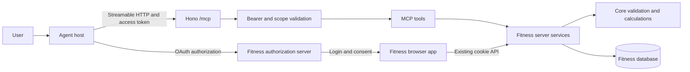
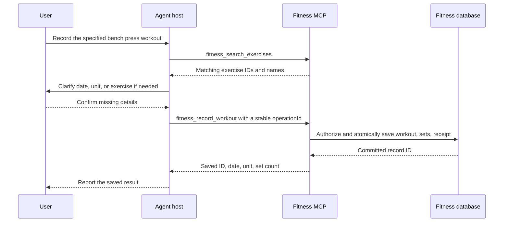

# Fitness MCP Server Design and Plan

## Goal

Let an agent record a user's completed strength training, read that user's records, and analyze training trends through Streamable HTTP. Keep Fitness as the source of truth. The agent interprets user language; Fitness validates data and calculates metrics.

Status: implementation and verification in progress on `narumi/feat/fitness-mcp`, based on `origin/main` at `7715092`. The server, OAuth services, additive migration, consent UI, and tools are implemented. The native client launch gate remains open: Claude Code and intermittently both Codex runtimes race refresh-token reuse. No production deployment is authorized or performed. Keep this plan until the remaining acceptance gates pass or the user explicitly accepts their disposition.

## Context

Repository baseline: `7715092`, inspected on 2026-10-22.

| Source | Existing behavior | Design consequence |
| --- | --- | --- |
| `apps/api/src/app.ts` | Hono routes, browser-oriented actions, and a global mutation Origin check | Add a distinct MCP route boundary; do not forward tool calls to form actions. |
| `apps/api/src/lib/auth.ts` | Hashed browser sessions and cookie-based `requireUser()` | Remote clients need separate bearer authentication. Do not give agents browser cookies or passwords. |
| `prisma/schema.prisma` | User-owned workouts and sets; shared exercise catalog with names and aliases | Derive ownership from authorization. Resolve exercise names before writing. |
| `apps/api/src/lib/recorded-workouts.ts` | Transactional creation with a user-scoped retry key | Reuse the transaction pattern, but add payload-bound idempotency for a complete workout. |
| `apps/api/src/lib/recorded-sets.ts` | Completed-workout writes and version increments | Do not build an agent workflow from separate workout and set writes. |
| `apps/api/src/lib/session-service.ts` | Live workout state transitions and optimistic versions | Keep live sessions outside the first release. |
| `packages/core/src/stats-calculations.ts` | Volume, frequency, trends, and estimated one-rep maximum | Reuse pure calculations instead of asking a model to calculate totals. |
| `packages/core/src/calendar.ts` | Local-calendar date keys | Preserve current date semantics; do not add an implicit timezone conversion. |
| `apps/web/src/lib/messages.ts` | Weights use kg; total volume includes warm-ups | Publish units and set inclusion rules in tool outputs. |

## Architecture



- Put MCP transport and tool adapters under `apps/api/src/mcp/`.
- Put reusable queries and writes under `apps/api/src/lib/`. Pass a verified principal explicitly. Do not make these services read browser cookies.
- Put public input/output schemas in `packages/contracts/src/mcp.ts`.
- Keep environment-neutral calculations in `packages/core`.
- Use the existing API process and database. A separate application, internal HTTP hop, or second Prisma client is not needed.
- Never store a current user in a shared MCP server instance. Tool execution must use the authenticated context for that request.
- The server does not run an LLM, receive chat transcripts, execute arbitrary code, or accept arbitrary SQL.

### Launch clients and compatibility

Support Pi, Codex CLI, and Claude Code through the same `/mcp` URL and tool schemas. Do not require a Fitness-specific client extension, stdio proxy, or adapter. Other standards-compliant hosts are compatibility candidates, not a reason to expand the first-release tool surface.

The following is documentation evidence checked on 2026-10-22, not an end-to-end compatibility result:

| Client | Documented remote support | Proposed connection and authorization | Verification still required |
| --- | --- | --- | --- |
| Pi | Built-in Streamable HTTP and OAuth; installed documentation is version 1.4.0 | User-level `~/.pi/agent/mcp.json`; select `oauth.clientRegistration: cimd`; sign in with `pi mcp login fitness` | Negotiated protocol, CIMD resolution, loopback callback, refresh, scope upgrade, tool exposure, and permission-extension behavior. |
| Codex CLI | Streamable HTTP, OAuth, CIMD, DCR, and pre-registered client IDs | User-level `~/.codex/config.toml`; advertise CIMD and public-client support; sign in with `codex mcp login fitness` | Exact tested version, negotiated protocol, callback, refresh, and read/write approval behavior. A scope-related `403` requires an explicit login rather than automatic scope escalation. |
| Claude Code | HTTP transport, OAuth, CIMD, and pre-registered clients; documents both v1 and v2 MCP runtimes | Add an HTTP server at user scope; sign in with `claude mcp login fitness` or `/mcp` | Exact tested version and runtime, modern and legacy negotiation, callback, refresh, and write approval behavior. |

Use CIMD as the primary registration path for all three. Advertise `client_id_metadata_document_supported: true`, `token_endpoint_auth_methods_supported` containing `none`, PKCE S256, and authorization-response issuer support. Pi requires an explicit CIMD configuration; do not assume its default DCR registration will work against a CIMD-only server. Keep pre-registered public clients as a supported fallback. Do not add DCR for hypothetical older hosts.

Publish connection examples without credentials in release documentation. Proposed examples, not commands executed during design:

Pi user-level configuration:

```json
{
  "mcpServers": {
    "fitness": {
      "type": "http",
      "url": "https://fitness.example.com/mcp",
      "oauth": { "clientRegistration": "cimd" }
    }
  }
}
```

Codex CLI user-level configuration:

```toml
[mcp_servers.fitness]
url = "https://fitness.example.com/mcp"
```

Claude Code user-level setup:

```bash
claude mcp add --transport http --scope user fitness https://fitness.example.com/mcp
```

Replace the example origin with the configured Fitness origin. Keep personal connections and tokens outside the Fitness repository. For all three clients, complete browser login before unattended runs; never solve a headless authorization failure by passing a password to the model.

The launch test matrix must record each client version, MCP runtime where applicable, negotiated protocol, registration mechanism, exact redirect URI, token refresh, read-only denial of writes, explicit write authorization, record/read/analyze results, and revocation. Record documentation support and tested support separately. Test the selected maintained release of each client; do not promise every historical version or every other host.

### Transport and protocol versions

Use `https://<configured-fitness-origin>/mcp` as the public resource URI. Use the existing API loopback address for local development.

The current specification resolves to revision `2026-07-28`. It differs from `2025-11-25`; do not combine their lifecycle rules.

| Concern | Proposed behavior |
| --- | --- |
| Transport | Streamable HTTP, not the deprecated separate `/sse` and `/messages` transport. |
| Modern protocol | Support `2026-07-28`, including `server/discover` and per-request metadata. No initialization handshake or protocol sessions. |
| Older clients | Plan SDK-supported `2025-11-25` compatibility alongside `2026-07-28`, because launch clients can use different MCP runtime generations. Verify initialization and legacy stateless operation separately. Do not claim any other revision or a working client/version pair before its test passes. |
| Requests | `POST /mcp` carries one JSON-RPC message. Validate protocol metadata and required headers through the SDK. |
| Responses | Use `application/json` for the first-release tools. This is valid Streamable HTTP; continuous SSE is not required. Clients must advertise JSON and SSE support as specified. |
| Modern headers | Validate `MCP-Protocol-Version`, `Mcp-Method`, and, where required, `Mcp-Name` against the body. Do not expose workout fields through custom mirrored headers. |
| GET and DELETE | Return `405` with `Allow: POST` for the modern endpoint. Older-version handling must follow the selected SDK compatibility mode. |
| Sessions | Do not issue a modern `Mcp-Session-Id`. Any legacy session identifier is never an authorization credential. |
| Streaming | No subscriptions, resumable streams, or asynchronous jobs in the first release. |
| Limits | Enforce a 256 KiB body limit before JSON parsing, a 15-second request deadline, and bounded query results. |
| Network | Require HTTPS in production. Keep development on loopback. Validate the configured Host and any supplied Origin. |

Use the official TypeScript SDK v2 server package, `@modelcontextprotocol/server`, with its Web Standard transport and the Hono integration where needed. Pin compatible released versions after the client proof. Do not implement JSON-RPC or compatibility detection by hand. The old monolithic `@modelcontextprotocol/sdk` is the v1 release line, not the proposed new-server dependency.

### Authentication and consent

Use OAuth 2.1 authorization code flow with PKCE S256. Fitness remains the account authority. The browser login and passkeys authenticate the user at the authorization server; only an MCP-specific access token reaches the agent host.

The proposed authorization server is part of the Fitness deployment and uses a maintained OAuth implementation. Selecting that implementation and proving its Fitness session integration are early gates. SDK metadata helpers alone do not provide a complete authorization server.

1. An unauthenticated MCP request returns `401` and a `WWW-Authenticate` challenge with `resource_metadata`.
2. Publish RFC 9728 protected-resource metadata at `/.well-known/oauth-protected-resource/mcp`. Use the exact configured `/mcp` resource URI and authorization-server issuer.
3. Publish authorization-server metadata through the chosen OAuth implementation.
4. The host opens browser authorization. Fitness requires login and shows the client identity, requested scopes, and that records will be sent to the agent provider.
5. The user grants read access, or read and write access. Consent is specific to the user, client, resource, and scopes.
6. Bind each short-lived, single-use authorization code to its client, registered redirect URI, PKCE challenge, user, resource, and granted scopes. Match redirect URIs exactly except for loopback port variation explicitly permitted by RFC 8252; never wildcard the host or path. Include authorization response issuer metadata and `iss` support.
7. Send access tokens only in `Authorization: Bearer ...`, never URLs. Validate expiry, revocation, resource audience, client binding, and scopes on every request.
8. Provide an authenticated Fitness page to inspect and revoke connected clients. Revocation must prevent subsequent tool calls.

Scopes:

| Scope | Permission |
| --- | --- |
| `fitness:read` | Read the shared exercise catalog and the user's own workout records and metrics. |
| `fitness:write` | Create completed workouts for that user. Does not grant editing, deletion, or administrator access. |

Read and write are separate grants; write does not imply read. Advertise read as the basic scope. Offer write through explicit consent or an insufficient-scope challenge, without granting it automatically.

Use opaque random access tokens with a proposed 15-minute lifetime. Store only token hashes. Issue rotating refresh tokens with a 30-day absolute lifetime for the selected CLI clients; store their hashes and revoke the token family on reuse. Keep browser `Session` rows separate from MCP grants and tokens. Test refresh and concurrent refresh behavior with each launch client.

Implement Client ID Metadata Documents as the primary registration path and pre-registered public clients as the fallback. Treat remote metadata fetching as an SSRF boundary: HTTPS, public destinations only, checks on every redirect and resolved address, and strict response size and time limits. Do not fetch client-provided logos or other display URLs automatically. Do not add deprecated Dynamic Client Registration unless a required launch client fails both supported registration paths in the client proof.

### Browser and MCP boundaries

The existing global mutation check requires a browser Origin and would reject normal server-to-server clients. Refactor route composition, not the global policy:

- Keep the existing mutation Origin and cookie rules on browser API actions, consent submissions, and connected-client changes.
- Give only the exact `/mcp` route bearer-only authentication. A browser cookie is not sufficient and does not select the MCP principal.
- Permit a missing Origin on authenticated machine requests. Reject a supplied Origin unless it is explicitly trusted. Check this on all MCP methods.
- Give OAuth protocol endpoints their own protocol-specific controls. The token endpoint must support legitimate non-browser exchanges without disabling consent-page CSRF protection.
- Do not use `startsWith('/mcp')` as a broad security exemption. Test neighboring paths and trailing-slash behavior.
- Do not derive resource URLs, issuers, redirect targets, or trusted origins from caller-supplied forwarded headers.
- Do not enable wildcard CORS. Add browser-hosted MCP origins only after a real client requires them.

## Tool Contract

Expose a small tools-only surface first. Resources, prompts, live timers, measurements, templates, schedules, shared-catalog mutations, administrator operations, update tools, and delete tools are not part of this release.

All inputs use strict typed schemas. Do not accept `userId`, owner, role, database filters, or a destination URL. Resolve the user from the validated grant. An administrator token still has access only to its own records through MCP.

| Tool | Scope | Input | Result |
| --- | --- | --- | --- |
| `fitness_get_context` | read | None | Account display name, granted scopes, current UTC instant, units, date rules, and limits. No credentials. |
| `fitness_search_exercises` | read | `query`, `locale`, `limit`, optional cursor | Exercise IDs, names, aliases, and metadata; candidate matches, not an automatic ambiguous selection. |
| `fitness_list_workouts` | read | `fromDate`, `toDateExclusive`, optional `exerciseId`, cursor, limit | Completed-workout summaries and next cursor. Notes are omitted. |
| `fitness_get_workout` | read | `workoutId` | One owned completed workout, ordered completed sets, notes, and version. |
| `fitness_get_training_summary` | read | `fromDate`, `toDateExclusive` | Workout count, training-day count, total and working-set volume, and weekly totals. |
| `fitness_get_exercise_progress` | read | `exerciseId`, `fromDate`, `toDateExclusive` | Per-workout working-set metrics, maximum weight, and estimated one-rep maximum, with source record IDs. |
| `fitness_record_workout` | write | Stable `operationId`, explicit date, optional title/notes, ordered sets | Saved workout ID, version, normalized date/units, saved set count, and whether this was a retry. |

### Data rules

- Require `YYYY-MM-DD` calendar dates. Range starts are inclusive; range ends are exclusive.
  - Do not derive a workout date from a UTC timestamp.
  - The repository has no per-user timezone. An agent must resolve “today” or “yesterday” in the user's known timezone, or ask for the date. Server UTC time is not the user's calendar date.
  - Use existing calendar helpers consistently. Test reads and writes under UTC and Asia/Taipei, including month boundaries. Do not change existing date storage in this feature.
- Use kg only. Accept a typed `weightKg`, not an unlabelled `weight` or an implicit lb conversion. Return volume as `kg_reps`.
- Each set requires an `exerciseId`, finite `weightKg` from 0 through 2000, integer reps from 1 through 1000, and `WORKING` or `WARMUP` type. Optional RIR is 0 through 10 in steps of 0.5.
  - Array order determines set order; do not accept a second conflicting order field.
  - Missing RIR is unknown, not zero. Do not use coercion that turns missing values into performed results.
  - Use current title and note length limits. All submitted sets represent performed, completed sets, not targets.
- Limit a workout to 1–200 sets. Limit list pages to 50 records, exercise search pages to 20 candidates, and query ranges to 366 calendar days.
  - Use stable keyset pagination ordered by date and ID. Bind opaque cursors to the principal and query; validate them and reapply ownership on every page.
  - Do not silently truncate aggregate calculations. Return a typed `RANGE_TOO_LARGE` if a range exceeds the proposed 50,000 performed-set analysis budget.
- The catalog is currently shared. Return public catalog fields, not creator account IDs or another user's usage history. User-specific usage must use the authenticated owner filter.
- For absent and other-user workout IDs, return the same `NOT_FOUND` result. Never disclose whether another user owns an ID.

### Atomic and retry-safe recording

Do not have the agent create an empty workout and then make one call per set. A single `fitness_record_workout` transaction must validate all exercise IDs and create the workout, all sets, and an idempotency receipt together.

Proposed new persistence: `McpWriteReceipt`, unique on `(userId, clientId, toolName, operationId)`, with a canonical normalized payload hash and resulting workout ID. Keep receipts while the user account exists. Do not store raw workout payloads in receipts.

- Require a UUID `operationId`. Reuse it for transport retries, including retries after a lost response.
- Same key and same payload: return the existing result without a new workout.
- Same key and different payload: return `IDEMPOTENCY_CONFLICT`; never overwrite the first workout.
- If a browser deletion has removed the recorded workout, retain the receipt as a tombstone and return `RESULT_REMOVED`; never recreate it as a retry.
- Serialize concurrent duplicate calls using database constraints and the existing user-row transaction pattern. Do not rely on an in-memory cache.
- Invalid sets or exercise IDs must roll back the complete transaction. Do not call separate transaction-owning services in a loop.
- New operation IDs represent new writes. Idempotency cannot recognize an agent that generates a different ID for the same intent; instruct the host to preserve it and check recent records when the previous outcome is unknown.

### User confirmation

OAuth write consent grants capability; it does not prove approval of each workout. The host should show a normalized summary and obtain user approval before calling the write tool when the request is ambiguous. A clear instruction to record a fully specified workout can be treated as the user's write intent under the host's policy.

Mark reads with `readOnlyHint: true`. Mark recording as non-read-only, non-destructive, and retry-idempotent under the operation-ID contract. Set `openWorldHint: false`. These annotations and tool instructions guide the host; they are not access controls. Do not claim that a model-supplied `confirmed: true` proves human consent. A mandatory server-verified per-write approval would require a separate Fitness browser approval flow and is not included in this proposal.

### Analysis and output

Fitness returns facts and metric definitions; the agent explains them and can compare multiple requested ranges. Do not add a generic `analyze(prompt)` tool.

- Include only `Workout.state = COMPLETED` and sets with `completed = true`.
- Total volume includes warm-ups; working-set volume and personal records exclude warm-ups, matching current core behavior.
- Estimated one-rep maximum uses the existing Epley formula: `weightKg * (1 + reps / 30)`. Label it as an estimate.
- Weekly buckets start on Sunday, matching the existing `weekKey`. Distinguish training days from workout count.
- Each analysis result includes date boundaries, unit names, set inclusion rules, generation time, counts, and source IDs for highlighted records. Empty data is not evidence of zero performance.
- Reuse or extract pure calculation helpers. Do not return unrelated all-time records or recent-period statistics from a bounded-range query. The current `calculateStats()` has such fields and needs an explicit result projection.
- Use MCP `structuredContent` with an output schema, plus a concise compatible text representation. Return stable machine-readable domain errors with `isError: true` for tool failures. Use SDK JSON-RPC errors for invalid envelopes or arguments.
- Missing or invalid credentials use HTTP `401`; insufficient scope uses HTTP `403` with a scope challenge. Keep the scope check at the HTTP boundary for the requested tool and repeat the permission check in its service. Authorization challenges must not become generic successful tool responses.
- Treat titles, aliases, and notes as untrusted data, not instructions. Return bounded plain text, never execute their content or follow embedded URLs. Analysis excludes notes by default.
- Do not log workout payloads, tool arguments/results, tokens, raw headers, or raw error messages. Log request ID, tool name, internal principal/client IDs, duration, and safe outcome codes only. Add per-user and per-client rate limits and concurrency limits before exposure; settle numeric thresholds in the client proof.

### Example recording flow



## Plan

Implementation evidence is recorded in `docs/hono-migration-verification.md` and `tests/mcp-clients.md`. Checked entries below indicate verified implementation work, not full launch readiness.

- [x] Inspect the API, authentication, workout model, date helpers, and calculations. Evidence: the source paths in Context at baseline `7715092`.
- [x] Check official transport, authorization, registration, and SDK documentation. Evidence: References below; latest transport resolves to `2026-07-28` and SDK main describes v2 as stable.
- [x] Select Pi, Codex CLI, and Claude Code as required launch hosts and record their documented connection and OAuth paths. Evidence: user selection and the documentation matrix in Launch clients and compatibility. This does not establish tested compatibility.
- [x] Prove SDK transport and choose the maintained OAuth implementation against all three clients. Evidence: native fixtures record discovery, CIMD (Pi) or pre-registration, login, scoped consent, exchange, refresh, seven calls, scope upgrade, revocation, callbacks, and modern/legacy protocols. Packages and rate limits are pinned. Host-session approval UI is not claimed; the separate concurrent-refresh launch gate remains failing.
- [x] Add typed MCP schemas in `packages/contracts/src/mcp.ts`. Evidence: 10 contract tests passed, including strict browser consent identity and seven tool schemas.
- [x] Add canonical Prisma migration `20261022150000_mcp` for grants, hashed tokens, and receipts. Evidence: both `test:training:sqlite` and `test:training:postgres` passed 15 tests, including additive legacy/empty upgrades, backup restoration, unique constraints, receipt tombstones, and account cascades. OAuth lifecycle cases pass in disposable SQLite and PostgreSQL API tests. SQLite schemas are generated, not maintained separately.
- [x] Add OAuth routes and consent/connected-client UI. Evidence: the 59-case production HTTPS browser suite passed in CI run `39808061618`, including login/passkeys, scope consent, deny, revoke, redirect/PKCE rejection, canonical client identity, frame headers, and English/Traditional Chinese strings.
- [x] Separate browser and MCP middleware and add `/mcp`. Evidence: 62-case SQLite/PostgreSQL API suites pass, including metadata/header validation, missing/invalid/audience/revoked tokens, scopes, Origin/Host and port checks, neighboring paths, methods, UTF-8/body limits, pre-verification admission/deadlines, cancellation, and unchanged browser CSRF checks.
- [x] Add six read tools and scoped services in `apps/api/src/lib/mcp-workouts.ts`. Evidence: two-user API tests cover ownership, cursor/query binding, keyset pages, bounded catalog fields, performed-only projections, empty data, and units.
- [x] Add atomic completed-workout recording. Evidence: API tests pass for invalid-set rollback, concurrent duplicate submissions, replay, payload conflicts, deletion tombstones, owner/client keys, cancellation, and active/revoked/expired/read-only grant revalidation under the user-row lock.
- [x] Add bounded analysis projections and calculation tests. Evidence: pure fixtures verify formulas, Sunday buckets, warm-up rules, explicit ranges, units, and source IDs; the 62-case SQLite API suite proves the exact 50,000-set budget passes and larger queries fail instead of returning incomplete totals.
- [x] Add client connection, permissions, retry, privacy, and recovery documentation. Evidence: `docs/mcp.md`, `docs/releasing.md`, `tests/mcp-clients.md`, and `docs/hono-migration-verification.md` record actual dummy-account workflows for all three hosts and distinguish core passes from the failing concurrent-refresh launch gate.

## Completion Checklist

These checks gate completion. Do not treat native workflow successes as proof that the complete client launch gate passes.

- [ ] Resolve client compatibility and OAuth library choices; record tested versions and approved deviations from this proposal.
- [x] Pass `npm run check`, `npm run build`, `npm test` (86 tests), and `npm run test:api` (62 tests), including MCP contracts, HTTP, ownership, retries, and budgets. Final local check/build/pure/pre-commit gates passed after source changes.
- [x] Pass `npm run test:training:sqlite` and `npm run test:training:postgres`: 15 tests passed in each disposable environment, including migration coverage. Only test-owned PostgreSQL containers were created and stopped.
- [x] Pass `npm run test:ui` and `npm run test:ui:production` in CI run `39808061618`: 59 cases passed in each mode, with disposable data, no server reuse, and test-owned cleanup. Local browser-context timeouts remain recorded separately.
- [ ] Complete the real-client workflow with dummy users on Pi, Codex CLI, and Claude Code. Confirm refresh, scope upgrade, grant revocation, and cross-user isolation, including two concurrent authenticated requests. Publish exact tested versions and protocols.
- [x] Review log capture, limits, and fail-closed authorization. Evidence: existing logging tests pass, private fixture text is absent from captured API logs, two independent source reviews found no remaining concrete production defect after fixes, and API tests verify body/rate/concurrency bounds and stalled-verifier deadlines.
- [x] Add `.changeset/fitness-mcp.md` for API, web, contracts, and core minor versions; `prek run -a` and `git diff --check` passed before the implementation commit.
- [x] Design execution was authorized by the user. Production deployment is not part of this delivery; no production workflow, tag, or publication was run. Keep this plan while launch and verification gates remain open.

## Risks and Unknowns

- Native Pi 1.4.0, Codex CLI 0.163.0 default/modern, and Claude Code 2.1.303 plus 2.1.308 v1/v2 were exercised with disposable accounts, loopback callbacks, and no model calls. Earlier core OAuth/seven-tool workflows passed. The launch gate remains failing on refresh races; a final Claude v2 rerun also failed during its sequential refresh stage. See `tests/mcp-clients.md`. Normal agent-session approval UI is not established by native machine calls.
- OAuth uses the pinned maintained `@node-oauth/oauth2-server` 5.3.1 implementation. SDK transport uses `@modelcontextprotocol/server` 2.3.1. Both are installed and exercised; SDK metadata helpers are not used as a substitute for an authorization server.
- MCP has access to sensitive training records. Consent must describe transmission to the selected agent provider. Fitness cannot control the provider's later retention or training policy.
- The current calendar uses server-local dates and no user timezone. Explicit input dates avoid guessing; regression tests must prevent a new MCP path from shifting existing dates.
- Shared exercise names and user notes can contain prompt injection. Bound output and treat it as data; do not rely on text sanitization to make model instructions trustworthy.
- Retry protection depends on a stable operation ID. Per-write human approval depends on the agent host unless an additional browser approval flow is authorized.

## Implementation Decisions and Open Gates

- Add SDK-supported `2025-06-18` stateless compatibility because default Codex CLI 0.163.0 actually negotiates that revision. Keep modern `2026-07-28` and legacy `2025-11-25`; do not require a client feature flag for default Codex operation.
- Show canonical client IDs beside self-declared names on consent and connected-client pages. Add frame protection to both development and production HTML.
- Enforce caller admission and the 15-second response deadline before token lookup, plus owner/client limits after verification. Peer identity comes from the socket, not forwarded headers. Per-client quotas are namespaced by user so a caller cannot exhaust every user's public host ID quota.
- Password changes keep independently granted OAuth access. Account recovery must include explicit connected-client revocation; this policy is documented rather than changed without a requirement.
- Do not relax refresh replay revocation to make native client races disappear. The native client gate remains nonzero and the plan remains open until upstream coordination is fixed or the user explicitly accepts the compatibility limitation.

## Rollback / Recovery

- Deploy only after separate production authorization. This design does not change `compose.yaml` or dispatch workflows.
- Make schema changes additive. Verify the previous application revision can run with the added tables before release.
- If MCP must be withdrawn, withdraw only the MCP and OAuth routes, revoke grants and token families, and roll back application code. Keep browser login, workouts, and existing API behavior available.
- Keep committed workouts and idempotency receipts. Do not roll back a feature by deleting user records or dropping new tables while an older or newer application may still use them.
- A lost response is recovered by retrying the same operation ID, not by inserting a replacement workout. Correct an incorrect saved workout through the existing Fitness UI in this release.

## References

Checked on 2026-10-22:

- [Streamable HTTP, revision 2026-07-28](https://modelcontextprotocol.io/specification/2026-07-28/basic/transports/streamable-http)
- [Protocol versioning and legacy compatibility](https://modelcontextprotocol.io/specification/2026-07-28/basic/versioning)
- [MCP authorization](https://modelcontextprotocol.io/specification/2026-07-28/basic/authorization)
- [OAuth client registration mechanisms](https://modelcontextprotocol.io/specification/2026-07-28/basic/authorization/client-registration)
- [Official TypeScript SDK and package layout](https://github.com/modelcontextprotocol/typescript-sdk)
- Pi 1.4.0 installed `docs/mcp.md` under `@earendil-works/pi-coding-agent`; [Pi repository](https://github.com/earendil-works/pi)
- [Codex MCP documentation](https://developers.openai.com/codex/mcp), which resolved to [ChatGPT Learn MCP, CLI surface](https://learn.chatgpt.com/docs/extend/mcp?surface=cli)
- [Claude Code MCP documentation](https://code.claude.com/docs/en/mcp)
