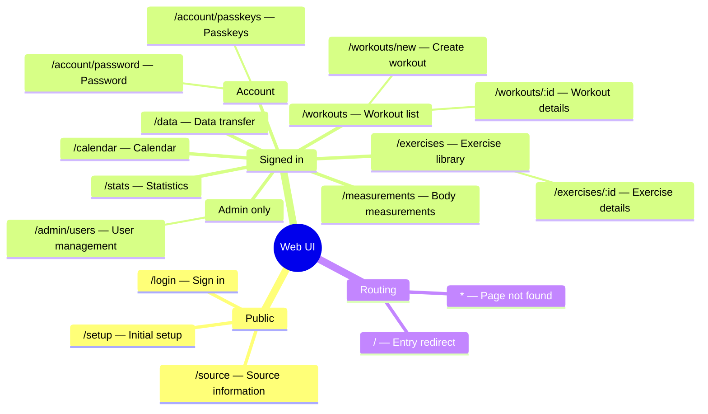

# Web UI/UX review plan

## Goal

Provide a clean, simple, visually consistent app that users can understand at a
glance, without reading instructions. A user should recognize the purpose of a
screen and its main next action after approximately one second.

Review every node in the Web UI page tree against this goal. Prioritize a clear
visual hierarchy, obvious actions, low reading effort, and easy task completion.
Use functional, accessibility, and responsive checks as necessary safeguards, not
as substitutes for a usable, good-looking interface. Produce evidence-backed
findings and specific acceptance criteria for later fixes.

The one-second goal concerns first impressions, not learning every feature or
completing a task in one second. Treat it as a target to test with people, not a
claim that source inspection or automated tests can prove.

Review execution started on 2026-10-22. The
[per-node report](../reviews/web-ui-ux-review.md) contains 17 findings, 142 rendered
samples, actual verification results, and simplification outlines. The
[participant guide](../reviews/web-ui-ux-participant-guide.md) defines the remaining
human checks; no participant results have been collected.

Completed preparation and verification tasks are checked below. Per-page tasks
with incomplete state, screen-reader, zoom, or physical-device checks remain open
even where the report contains source, screenshot, keyboard, and axe evidence.
Do not interpret an open task as no review performed, or an automated pass as
proof of one-second comprehension.

External requirements still open: first-time participants, a screen-reader/device
session, an isolated Docker environment for production-mode browser tests, and
user acceptance of the report or explicit acceptance of each documented limit.
The plan must remain until its closure conditions are met.

## Design criteria

1. **One clear next action:** Each actionable page state has one visually dominant action. Secondary actions must not compete with it. Read-only pages need a clear purpose and navigation, not an invented primary button.
2. **Structure before explanation:** Use grouping, order, spacing, and familiar controls to explain the workflow. Flag layouts that require introductory paragraphs to make sense.
3. **Minimal useful text:** Keep short, specific headings, visible field labels, units, and verb-based action labels. Identify repeated descriptions, redundant metrics, and instructional text that can be removed. Do not replace clear labels with unexplained icons.
4. **Essential controls first:** Keep the common task visible. Recommend moving advanced filters, optional metadata, templates, schedules, and detailed explanations behind clearly named secondary controls when they distract from that task. Do not hide required input, errors, or safety information.
5. **Consistent visual treatment:** Compare typography, spacing, alignment, content width, color, icons, borders, and action styles across pages. Use the existing Radix components and theme as the baseline. Flag arbitrary variation and excessive cards, badges, or decorative elements.
6. **Clear current state:** Show what is selected, in progress, saved, or failed near the relevant action. Use brief contextual feedback instead of persistent explanatory prose. Do not rely on color alone.
7. **Safe simplicity:** Preserve accessible names, keyboard support, necessary confirmations, password guidance, data units, and actionable error messages. Fewer words or clicks is not an improvement if users make more mistakes.

For each recommendation, state what to retain, remove, combine, defer, or restyle,
and explain how that change improves understanding. Do not prescribe a new feature
when a simpler layout or label solves the observed problem.

## Context

- Route source: `apps/web/src/app.tsx`.
- Navigation source: `apps/web/src/components/navigation.tsx`.
- Page implementations: `apps/web/src/pages/`.
- Existing UI rules: [Dashboard UI](../dashboard-ui.md).
- Existing browser coverage: `apps/web/e2e/`.
- Safe browser runner: `tests/run-ui.mjs` and `playwright.config.ts`.

The tree describes information architecture, not nested React layouts. Account,
Admin only, Public, Signed in, and Routing are review groups, not additional pages.

## Non-Goals

- Do not redesign or change application behavior during the review.
- Do not add routes or features to resolve assumed needs.
- Do not use production services, databases, accounts, or workout records.
- Do not treat browser route guards as proof of API authorization.

## Plan

### 1. Prepare the review

- [x] Confirm the tree against the current route declarations and record the reviewed commit in `docs/reviews/web-ui-ux-review.md`; evidence: every route and group below has a report entry.
- [x] Establish the main user goal and next action for each page state before judging its layout; evidence: the report includes an action hierarchy, explicitly distinguishing live training from retrospective logging without assuming which must dominate the workout landing page.
- [x] Map existing browser specs to the review tasks and identify missing coverage; evidence: the report lists spec paths and gaps without treating old results as current results.
- [x] Prepare disposable fixtures for no users, a new user, an active user, another user, and an administrator; evidence: fixture descriptions cover empty, populated, long-content, and more-than-20-workout states without real user data.
- [x] Establish an isolated browser run through `npm run test:ui` on port 8784; evidence: record the command and result, refuse server reuse, and confirm the runner stops its own processes. If the port is occupied, record the blocker; do not stop an existing service.

### 2. Apply the same review method to every node

For each node task below:

- Record the user goal, entry points, primary action, exit path, and observed result.
- Review visual clarity before functional detail: what draws attention first, whether competing actions distract from the main task, and what users must read before they can act.
  - Record the visible headings, action labels, and explanatory blocks in the initial viewport. Recommend removing or deferring text that does not help the immediate task; do not use word count alone as a quality score.
  - Record typography, spacing, alignment, density, and component consistency against the design criteria. Link each visual concern to an affected task or a specific consistency defect, not only personal preference.
  - For each page state, propose the simplest hierarchy: purpose, main content/input, primary action, then secondary controls. Include a concise before/after content outline for any proposed structural change.
- Inspect desktop at 1440 × 900 and mobile at 390 × 844 in English and Traditional Chinese.
  - Check 320 CSS-pixel reflow and 200% zoom for clipped text, hidden actions, and page-level horizontal scrolling. Record any necessary local table scrolling separately.
- Check heading order, labels, contrast, visible focus, keyboard order, and touch target size against applicable WCAG 2.2 AA criteria.
  - Use axe for automated checks. Also use keyboard-only navigation and a screen-reader smoke check; automated checks do not establish full accessibility compliance.
- Exercise applicable initial, empty, populated, loading, invalid-input, pending, success, failure, and recovery states.
  - Use controlled network delays and failures. Confirm failed mutations retain entered values and do not silently repeat a write.
  - Mark an inapplicable state with a reason. Mark an untested state as not reviewed, not passed.
- Record evidence as a test assertion, a reproducible manual observation, or an ignored local screenshot/trace reference under `test-results/`.
  - Use synthetic data. Do not commit screenshots or include credentials, tokens, raw headers, passkey material, or private records in evidence.

Each checkbox requires a report entry with the applicable checks, actual evidence,
and findings or an explicit no-finding result. Source inspection alone does not
complete a browser interaction or visual check.

### 3. Review the root and public nodes

- [ ] **Web UI root:** Review the shared shell, brand destination, language selector, skip link, content width, page headings, route focus, scroll behavior, and bootstrap loading/error/retry states; evidence: shared-shell results for signed-out and signed-in users at both viewports and locales.
- [x] **Public group:** Review navigation before authentication and the transition between setup and login; evidence: a no-user environment reaches setup, an existing-user environment reaches login, and signed-in users do not remain on public authentication forms.
- [ ] **`/setup`:** Review first-run instructions, administrator creation fields, password guidance, validation, pending feedback, failure recovery, and successful entry into the app; evidence: successful setup and invalid/failed submission cases in a fresh disposable database.
- [ ] **`/login`:** Review password and passkey sign-in discoverability, field labels, password-manager support, invalid-credential feedback, pending state, and passkey cancellation/failure recovery; evidence: successful sign-in and failed/cancelled paths without misleading success feedback.
- [ ] **`/source`:** Review source/license content, link purpose, readability, and return navigation; evidence: source links work and content is accessible while signed out and signed in.

### 4. Review signed-in navigation and workout nodes

- [ ] **Signed in group:** Review all six primary destinations, active and nested-route indicators, mobile utility-link visibility, account access, sign-out, and expired-session feedback; evidence: every destination is reachable by keyboard and touch, and logout/session expiry removes private content.
- [ ] **`/workouts`:** Review summary hierarchy, history scanning, month grouping, state badges, completed/prescribed progress, search, filters, clear actions, 20-row pagination, and empty/no-result guidance; evidence: filters affect history without changing all-time summaries and navigation retains the intended filter state.
  - Review the distinction between retrospective creation and live training, plus repeat, continue, template, and schedule controls. Evidence must show these actions are discoverable without competing ambiguously.
- [ ] **`/workouts/new`:** Review date/title/notes entry, calendar date prefills, primary action, cancel behavior, validation, pending feedback, and draft recovery; evidence: successful creation reaches the correct workout and a failed/lost response can be retried without duplicate creation.
- [ ] **`/workouts/:id`:** Review completed-workout summary, metadata editing, set entry/edit/delete, previous-session copying, units, warm-up/working-set distinctions, template saving, repeat, and delete confirmation; evidence: these tasks work on desktop and mobile with clear saved-state feedback.
  - Review live-session states separately: start, actual-value entry including zero weight, complete set, pause, resume, finish with skipped sets, abandon, and conflict recovery. Evidence must show keyboard cancellation, retained drafts, and clear state transitions without duplicate writes.
  - Review missing and another user's workout IDs. Evidence must show a safe, understandable outcome without private content.

### 5. Review calendar, statistics, and exercise nodes

- [ ] **`/calendar`:** Review Sunday-first month layout, previous/next/today controls, selected date versus today, adjacent-month dates, workout markers, dense days, empty days, selected-day details, and mobile agenda order; evidence: keyboard-accessible dates and detail links work, and creation preserves the selected local date across month/year boundaries.
- [ ] **`/stats`:** Review range controls, overview hierarchy, chart labels, units, legends, empty/sparse data, non-color cues, and access to values without hover; evidence: URL ranges survive reload and displayed totals/records match synthetic fixtures and documented completed-set, warm-up, and date rules.
- [ ] **`/exercises`:** Review search by localized name and alias, sorting, metadata filters, result counts, creation, no-result guidance, and links to detail pages; evidence: long bilingual names remain readable and personal use counts/dates do not include another user's workouts.
- [ ] **`/exercises/:id`:** Review name/alias hierarchy, history and records, renaming, metadata editing, duplicate feedback, disclosure state, and ownership-dependent controls; evidence: failed edits retain entered values, successful renaming preserves record identity, and missing/non-editable records have clear outcomes.

### 6. Review measurements and data nodes

- [ ] **`/measurements`:** Review metric labels and units, date entry, target weight, history/trends, same-date replacement, empty data, validation, and delete cancellation; evidence: users can predict replacement behavior, saved values survive reload, and clearing a target does not remove measurements.
- [ ] **`/data`:** Review import/export explanations, file selection, format guidance, preview, exercise mapping, confirmation, cancellation, duplicate handling, and import results; evidence: preview/cancel makes no write, invalid files have actionable feedback, repeat imports do not duplicate records, and exports contain only the current user's permitted data.

### 7. Review account and administration nodes

- [ ] **Account group:** Review the header account destination and navigation between password and passkeys; evidence: both security tasks are discoverable and users can return to primary navigation without a dead end. Do not assume an account landing page exists.
- [ ] **`/account/password`:** Review current/new/confirmation labels, password-manager attributes, password requirements, mismatch/incorrect-password feedback, pending state, and success feedback; evidence: users can correct an error and confirm a successful change without exposing password values.
- [ ] **`/account/passkeys`:** Review registration instructions, names/list entries, device support feedback, password checks, cancellation, removal confirmation, and recovery paths; evidence: registration, cancelled registration, and removal outcomes are clear, with virtual-authenticator results distinguished from physical-device observations.
- [x] **Admin only group:** Review role-dependent navigation and direct entry as an administrator, regular user, and guest; evidence: only administrators see the administration link and unauthorized entry produces a safe route outcome. Reference API coverage separately for authorization evidence.
- [ ] **`/admin/users`:** Review user-list scanning, create-user controls, roles, password actions, available account mutations, and destructive safeguards; evidence: administrator workflows provide clear validation/results and regular-user attempts do not reveal or change protected data.

### 8. Review routing nodes and cross-page journeys

- [ ] **Routing group:** Review direct URLs, reload, browser back/forward, malformed query/hash values, missing records, and separation of authentication expiry from forbidden/not-found outcomes; evidence: navigation reaches a stable page without redirect loops, lost focus, or stale private content.
- [x] **`/`:** Review all entry redirects with no users, a signed-out user, and a signed-in user; evidence: destinations are `/setup`, `/login`, and `/workouts` respectively, without an intermediate private-page display.
- [ ] **`*`:** Review an unknown URL while signed out and signed in for an understandable localized message and an available recovery path; evidence: keyboard users can reach login or a valid signed-in destination without editing the URL.
- [ ] Review the complete first-run journey from setup through exercise creation, workout creation, set entry, calendar, and statistics; evidence: a linked walkthrough records each transition and any point where users cannot identify the next action.
- [ ] Review the returning-user journey from history through repeat/start, pause/resume, completion, and progress review; evidence: the report distinguishes live training from retrospective entry and verifies completed results across pages.
- [ ] Review recovery journeys for expired sessions, failed saves, import cancellation, and account switching; evidence: the report records retained/lost input, recovery actions, and confirmed isolation of private state.

### 9. Test first-glance understanding and unassisted use

- [ ] Run a one-second first-impression check for every rendered page, including distinct empty and active-session states; evidence: the report records the displayed state, expected purpose/action, and observed answers. Group and redirect nodes use their destination screens rather than artificial screenshots.
  - Show the page for approximately one second, then hide it. Ask what the page is for and what action the participant would take next. Do not explain the UI or name the expected control first.
  - For read-only pages, ask what information the page provides rather than requiring a primary action.
  - Start with reviewer observations across all pages. Mark these as expert judgments, not proof of first-time-user understanding.
- [ ] Validate the core entry, workout creation, live-session, exercise-selection, and progress-review screens with at least five people unfamiliar with the app; evidence: anonymized responses, locale familiarity, viewport, page state, and exposure order are recorded. Counterbalance order where practical and record prior exposure instead of treating learned responses as first impressions.
  - Target: at least four of five participants identify the purpose and intended next action after the one-second exposure for each tested screen. Record results per screen; do not hide a weak screen in an app-wide average.
  - Include English and Traditional Chinese sessions and both mobile and desktop views. State the sample size for each context; do not claim an untested context passed.
  - If participants are unavailable, leave human validation blocked and request user acceptance of that limitation. Do not substitute model-generated answers or click tests for participant evidence.
- [ ] Observe the same participants completing a first workout and finding its progress information without a tutorial or reviewer guidance; evidence: task success, first-click correctness, wrong turns, help requests, and any need to read instructional paragraphs are recorded.
  - Target: at least four of five complete each core task without guidance or a critical error. A fast first impression does not pass a workflow that later confuses users.

### 10. Record and prioritize findings

Create `docs/reviews/web-ui-ux-review.md` during review execution with:

- A coverage table: node, goal, intended next action, role, data state, locale, viewport, checks performed, evidence, status, and finding IDs.
- A per-node design assessment: first-glance clarity, reading effort, action hierarchy, visual consistency, and the simplest recommended change. Distinguish expert judgments from participant results.
- One entry per finding: ID, affected node(s), reproduction steps, expected versus observed behavior, user impact, severity, evidence, recommended correction, and testable acceptance criteria.
- A separate list of hypotheses and blocked checks. Do not present either as verified defects.
- Shared-component findings recorded once and linked from each affected node.

Use these severity rules:

1. **Critical:** Exposes private data or permits unintended destructive changes.
2. **High:** Prevents a core task, loses entered data, or blocks keyboard/screen-reader completion without a reasonable alternative.
3. **Medium:** Causes task errors or substantial confusion, but a practical alternative exists.
4. **Low:** A consistency or presentation issue that does not block the task.

- [x] Consolidate and prioritize verified findings; evidence: every finding has a severity, reproducible observation, affected nodes, and measurable acceptance criteria. After safety and accessibility blockers, prioritize unclear main actions and core workflows that require explanations before minor visual polish. Failed participant tasks can be High severity even when the underlying feature works.
- [x] Record verification commands and manual results in the report; evidence: actual run status, environment, spec names, and artifact references are present, with failures and unavailable checks left explicit.
  - Run `npm run test:ui` for the development browser baseline and `npm run test:ui:production` for the isolated PostgreSQL/HTTPS baseline. The production-mode command does not authorize deployment. Record missing Docker or browser support as a blocker, not a pass.
  - If review work adds or changes test code, run `npm run check`, relevant browser specs through the runner, and `npm run build` if API, schema, route, or UI code changes.
- [x] Prepare a fix handoff without implementing changes; evidence: Critical/High findings have a proposed owner or an explicit unassigned status, and all deferred work has a reason and acceptance criteria.

## Completion Checklist

- [ ] Every tree node has a completed evidence-backed report entry, including groups, `/`, and `*`.
- [x] Every rendered page has a visual-clarity and reading-effort assessment with a specific action hierarchy; recommendations simplify the interface without removing necessary labels or safeguards.
- [ ] First-glance and unassisted-task results meet the stated targets on the tested core screens, or the user explicitly accepts each failed target or validation limitation. Expert review is not reported as participant validation.
- [x] The report contains a prioritized simplification proposal with concise before/after outlines for structural changes, not only a list of functional defects.
- [ ] Every page has desktop/mobile and English/Traditional Chinese observations; missing checks remain open until completed or explicitly accepted as a limitation by the user.
- [ ] Applicable failure, recovery, keyboard, screen-reader, and responsive checks have actual results, not only source-based expectations.
- [ ] Cross-page journeys have reproducible outcomes and linked findings. Scripted scenario mapping is recorded, but the linked first-run/returning/recovery walkthrough tasks above and unassisted participant observations remain open.
- [x] The report separates verified defects, no-finding results, hypotheses, and accepted limitations.
- [x] Browser command results and cleanup are recorded; unavailable environments are not reported as passed.
- [x] Findings are ready for a separate implementation task; no redesign, production operation, or unrelated code change is included.
- [ ] Obtain user acceptance of the report and any remaining limitations; then remove this completed plan under the plan lifecycle rules.
