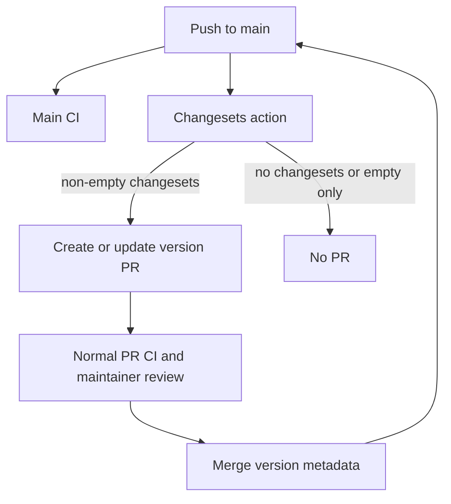

# Version-only releases

Changesets automate private workspace versions and changelogs through a reviewed
pull request. There is no package publishing, tag push, GitHub Release, automatic
merge, container publication, or deployment in this workflow.

## Package policy

- Keep all four workspace packages private and independently versioned:
  - `@narumitw/fitness-core`
  - `@narumitw/fitness-contracts`
  - `@narumitw/fitness-api`
  - `@narumitw/fitness-web`
- Keep `fixed` and `linked` empty.
- Keep `privatePackages.version: true` and `privatePackages.tag: false`.
- Keep `updateInternalDependencies: patch`.
- Keep root tooling private and outside workspace version bumps. Its workspace
  dependency ranges and lockfile still need to match the versioned packages.
- Do not add npm credentials, OIDC publishing permissions, or a publish command.

## Automated version PR

`.github/workflows/release.yml` uses the official
[Changesets GitHub Action](https://github.com/changesets/action) on pushes to
`main`. It installs dependencies and lets the action create or update the
version PR. Main CI runs in parallel; the version job does not wait for it.
The version PR still requires normal CI and maintainer review before merging.



The action handles changeset detection, version commits, and PR updates.
There is no custom CI-completion listener or SHA-checking script. Version jobs
are serialized without cancelling an update in progress.

It uses immutable action SHAs, Node 24, `npm ci`, no restored package cache, and
no persisted checkout credentials. The existing version command remains:

```sh
npm run version-packages
# changeset version && npm install --package-lock-only --ignore-scripts
```

Changesets Action v2 is configured with `version-script`, without
`publish-script`, and with GitHub releases/tag pushes explicitly disabled.
This matches Changesets CLI 3. Do not copy the old v1 input names or pass a custom
token only through the `GITHUB_TOKEN` environment variable.

Only-empty changesets do not create a version PR. They remain until a real
release consumes them. The action owns `changeset-release/main`; put ordinary
changes on a separate branch rather than editing that generated branch.

## Repository owner setup

Before enabling the workflow on main:

1. Store the existing personal access token as repository Actions secret
   `PAT_TOKEN`.
   - Enter the token in GitHub settings, not in source files or chat.
   - For a fine-grained token, select only this repository and grant Contents
     and Pull requests read/write permissions. Grant no other write permissions.
   - The token owner must have write access. Do not add the owner to
     branch-protection or ruleset bypass lists for this workflow.
2. Check the repository's Actions policy permits automated PR creation.
   - The official action documents the `Allow GitHub Actions to create and approve
     pull requests` setting. This workflow does not approve or merge PRs.

The built-in workflow token has only Contents read. The action receives
`secrets.PAT_TOKEN` through `github-token`. PAT-created PRs and updates can
trigger normal PR CI; the default `GITHUB_TOKEN` generally cannot do so.
Do not silently fall back to it. No GitHub App setup, private key, or `NPM_TOKEN`
is needed.

Live PAT authentication, repository rules, and PR creation require the owner's
setup and an authorized main merge. Local checks do not establish that these
external prerequisites are configured.

## Changes in an ordinary PR

Each ordinary PR must add a new `.changeset/*.md` file. Editing an existing
changeset does not meet this rule.

For a user-visible change, select the affected packages and version types:

```sh
npm run changeset
```

A noninteractive package changeset can use:

```md
---
"@narumitw/fitness-web": patch
---

Describe the user-visible result.
```

Use an empty changeset for tooling, documentation, or private implementation
changes that do not need a version bump:

```md
---
---
```

Do not require a package bump for every private implementation edit.

## CI changeset checks

CI fetches complete Git history and checks the selected PR base. The presence
check accepts a new committed package or empty changeset. It rejects uncommitted
files, deleted files alone, README/config edits, and edits to existing changesets.

Generated version PRs need a narrow exception because versioning consumes the
changesets. `scripts/check-changesets.mjs` verifies all of these conditions:

- The event is `pull_request`, the author type is `User` (PAT) or `Bot`, and both
  PR repositories match `GITHUB_REPOSITORY`.
- Head is exactly `changeset-release/main`, base is `main`, and the title is
  `chore(release): version packages`.
- At least one existing changeset is deleted.
- Every changed path is a consumed changeset, a modified root/workspace
  `package.json`, modified `package-lock.json`, or an added/modified changelog
  in one of the four workspace directories.
  - Source files, workflows, configuration, README edits, and other paths fail.

This is a release-metadata classification, not an authorization boundary.
Maintainer review must still verify manifest contents and dependency ranges.

The checker emits `version-pr=true` only for that exception. CI then validates
Changesets status against `HEAD` because the version PR has already applied its
plan. Ordinary PRs use `origin/main` and still need a new changeset. A blanket
author or branch-prefix exemption is not allowed. Installation, lint, types, build,
unit/API/database/browser tests, and normal branch protection are not skipped.

```sh
npm run check:changesets -- --base origin/main
npm run test:changesets
```

Review each generated PR's versions, changelogs, internal ranges, root lockfile,
and consumed changesets. Require its normal CI and maintainer approval before
merging. No deployment follows the merge; `deploy.yml` remains manual.

## Recovery

If the PAT is missing, expired, or lacks write permissions, the version PR cannot
be written. The owner can correct `PAT_TOKEN` and rerun the Release job for the
latest main push. Do not rerun an older job after main has advanced.

To stop automation, the owner can disable the Release workflow and close the
unmerged generated PR. A reviewed revert of this workflow and its CI integration
restores the manual process. These are separate repository-owner actions, not
local verification steps. No database, tag, publication, or deployment rollback
is part of this change.

## Manual fallback and safe rehearsal

For a manual version PR, start from clean reviewed main on a release branch such
as `narumi/chore/version-packages`. Run `npm ci`, review
`npm run changeset -- status`, then run `npm run version-packages`. Review the
same metadata and run installation, tests, checks, and build. Add a new empty
changeset because this manual branch does not match the generated-PR exception.

For local experiments, use a disposable clone, not the production checkout:

```sh
scratch=$(mktemp -d)
git clone --no-hardlinks --no-local . "$scratch/fitness"
(
  cd "$scratch/fitness"
  git show-ref --verify --quiet refs/heads/main || git branch main origin/main
  npm ci
  npm run version-packages
  git diff --check
  git diff -- package-lock.json package.json packages apps .changeset
  npm ci
  npm run check
  npm run build
)
```

The local main reference is required by Changesets status comparisons, even when
the source checkout is a feature branch. Verify real package and empty-only
cases, internal ranges, lockfile consistency, and unchanged original versions/tags.
Never run publish/tag/release/deploy commands as part of the experiment. Remove
only the disposable clone when finished.

## References

- [Changesets automation and version-only mode](https://changesets.dev/guide/automating)
- [Private applications](https://changesets.dev/guide/beyond-npm)
- [Changesets Action v2.1.2 API/source](https://github.com/changesets/action/tree/ae32849d5ba541f9ae29e40e22a623bc13562f51)
- [Managing personal access tokens](https://docs.github.com/en/authentication/keeping-your-account-and-data-secure/managing-your-personal-access-tokens)
- [Workflow-trigger token behavior](https://docs.github.com/en/actions/how-tos/write-workflows/choose-when-workflows-run/trigger-a-workflow#triggering-a-workflow-from-a-workflow)

Local references inspected: `~/src/pi-extensions/.github/workflows/publish.yml`
for scoped permissions and pinned actions; `~/src/pi-browser-agent/`
for lockfile synchronization; Otter, Morsel, and TypeScript Template for their
release patterns. Their package/tag/container publishing paths were not copied.

## Deployment runner

The manual deployment runs on a self-hosted runner with Docker Compose installed.
Before building, the workflow checks Docker availability. If Docker is unavailable
on macOS and the selected context is `orbstack`, it runs `orbctl start` and waits
for Docker. The readiness step has a three-minute timeout and fails before the
build if Docker remains unavailable. It does not switch Docker contexts or reset
Docker data. Keep `orbctl` on the runner's PATH.

Starting OrbStack can resume existing production containers. Test workflow
changes with mocked commands; dispatch the workflow only with explicit production
authorization.

## Password hash compatibility and recovery

New and changed passwords use the `bcrypt-sha256:v1:` format: a domain-separated
SHA-256 digest, encoded as base64, is hashed with bcrypt at cost 12. The digest is
not stored. New hashes verify the full password, including bytes after byte 72.
Existing unmarked bcrypt hashes remain accepted without a data migration. They
retain the historical 72-byte limit until the account password is changed; the
original discarded suffix cannot be recovered.

Before a separately authorized rollout, verify new account creation, legacy
login, a password change whose suffix differs after byte 72, and revocation of
old sessions. The SQLite regressions cover these cases; PostgreSQL and HTTPS
checks require a separate available test environment.

After new-format hashes are written, do not roll back to a build that only
supports unmarked bcrypt. Retain the version-aware verifier in a rollback build.
Do not reset passwords or restore an old database over newer records as an
application rollback. This change does not authorize a deployment.

## Fitness MCP rollout and recovery

See [MCP setup and permissions](mcp.md) and the MCP section of
[verification evidence](hono-migration-verification.md). Connecting a development
client, merging the feature, or preparing this checklist does not authorize a
production deployment.

Before a separately authorized rollout:

1. Verify the configured exact HTTPS `PASSKEY_ORIGIN`. The OAuth issuer and MCP
   resource use this origin, not forwarded headers. Verify the public proxy
   preserves the expected Host and routes `/mcp`, `/oauth/authorize`,
   `/oauth/token`, and `/.well-known/` to the API without rewriting discovery.
2. Review the additive migration `20261022150000_mcp`. Retain the previous
   application image and an authorized database backup. Run the SQLite and
   PostgreSQL upgrade/backup tests; do not replace them with `db push` in production.
3. Verify HTTPS discovery, login, denial, read-only access, explicit write scope,
   recording retries, token refresh, and grant revocation using dummy accounts.
   Publish the exact Pi, Codex CLI, and Claude Code versions and protocols tested.
   Do not infer client compatibility from an HTTP-only test.
4. Confirm that shared ingress limits cover all API instances. The built-in
   per-user/client limits apply to one process. Do not expose an unlimited
   multi-instance authorization endpoint.
5. Check the consent privacy warning and English/Traditional Chinese UI. Verify
   logs do not contain credentials, raw errors, request arguments, or workout data.
6. Use the existing separately authorized migration/deployment procedure. Do not
   publish packages, create release tags, or dispatch a workflow as part of an MCP
   connection check.

For withdrawal, revoke connected grants and withdraw the MCP/OAuth protocol routes
through a reviewed application rollback. Keep browser login and the existing
Fitness API available. Leave added tables in place so both application revisions
can run. Do not delete saved workouts, drop receipt tombstones, or restore an old
database over new user records as a feature rollback. A lost write response is
resolved with the same `operationId`, not a replacement insertion.

Pre-registered public OAuth clients can be created by an authorized database
operator through `McpClient`. Store `redirectUris` as a JSON string array and set
`preRegistered` to true. Use an exact HTTPS callback or an explicitly registered
loopback HTTP callback. Only loopback port variation is permitted; host and path
must match. Do not store a client secret for these public CLI clients or add an
unauthenticated registration route. Prefer CIMD for the documented launch clients.
