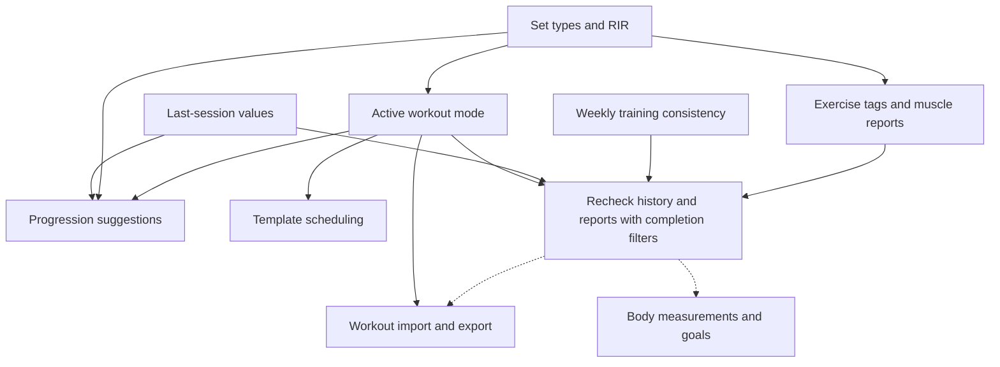

# Fitness Feature Roadmap

Updated: 2026-10-11

## Goal

Improve strength-training entry, execution, and analysis before expanding into broader health tracking.

This roadmap covers nine drafted feature plans. It defines delivery order and release conditions, not delivery dates or authorization to implement. All nine features are planned; none is marked delivered here.

## Current Baseline

The app supports workout and set logging, correction, duplication, templates, exercise aliases and history, a calendar, volume statistics, personal records, and estimated one-rep maximum (1RM).

Local scripts convert Markdown to CSV and import CSV. They do not provide authenticated database export or safe web import. The current importer replaces the first user's workouts on matching dates and must not become the web import path.

## Delivery Phases

### Phase 1: Faster Entry and Clearer Activity

| Feature plan | Outcome | Dependency |
| --- | --- | --- |
| [Last-session values](plans/2026-10-11_last-session-values-plan.md) | Show earlier exercise values and copy them into editable set fields. | None |
| [Weekly training consistency](plans/2026-10-11_weekly-training-consistency-plan.md) | Show weekly training days, weekly streaks, and a yearly activity heatmap. | None |

Deliver these features first because they use existing records without a schema migration. They can be implemented independently, but both touch workout-history behavior.

**Release conditions:** Prior-session values exclude the current workout, same-day sessions, future dates, and other users. Consistency tests cover Sunday-start weeks, duplicate training dates, open weeks, and corrected history. Neither feature stores derived counters.

### Phase 2: Reliable Training Records

| Feature plan | Outcome | Dependency |
| --- | --- | --- |
| [Set types and RIR](plans/2026-10-11_set-types-and-rir-plan.md) | Distinguish warm-up and working sets; record optional reps in reserve (RIR). | None |
| [Active workout mode](plans/2026-10-11_active-workout-mode-plan.md) | Start, pause, resume, and finish training with completed sets and a rest timer. | Set types and RIR |

Implement set classification before session state. Preserve existing records as completed working sets with unknown RIR. Separate planned targets from performed values.

**Release conditions:** Legacy data retains its values and expected reports. Completed sets in completed workouts determine performed training; active, paused, abandoned, and uncompleted work cannot create volume, records, or streaks. Apply this rule to Phase 1 features and every existing report. Reload and retry tests show no lost confirmed changes.

### Phase 3: Analysis and Planning

| Feature plan | Outcome | Dependency |
| --- | --- | --- |
| [Exercise tags and muscle reports](plans/2026-10-11_exercise-tags-and-muscle-reports-plan.md) | Filter by muscle and equipment; show weekly working sets by muscle. | Set types and RIR; integrate active-mode completion rules |
| [Progression suggestions](plans/2026-10-11_progression-suggestions-plan.md) | Explain and suggest one weight increment after all prescribed working sets meet their targets. | Set types and RIR, active workout mode, and last-session display integration |
| [Template scheduling](plans/2026-10-11_template-scheduling-plan.md) | Assign templates to weekdays and compare planned sessions with completed training. | Active workout mode |

Complete Phase 2 before releasing these features. Metadata discovery can start earlier. Progression and scheduling do not require muscle tags, but both need stable template lineage and session targets.

**Release conditions:** Shared exercise metadata has enforced edit permissions. Muscle rows distinguish primary and secondary involvement and are not summed as whole-body totals. Suggestions require explicit acceptance and reject stale or failed-session evidence. Schedule edits and template deletion preserve history; repeated starts create one session per planned occurrence.

### Phase 4: Measurements and Data Access

| Feature plan | Outcome | Dependency |
| --- | --- | --- |
| [Body measurements and goals](plans/2026-10-11_body-measurements-and-goals-plan.md) | Track daily body weight and waist measurements with trends and a target-weight line. | None; scheduled here to keep training work first |
| [Workout import and export](plans/2026-10-11_workout-import-export-plan.md) | Export database workouts and import a versioned app CSV through preview and confirmation. | Stable set and session fields from Phase 2 |

Measurements can be implemented independently. Deliver the transfer UI after session fields are stable so its first format preserves targets, completion state, set type, and RIR.

**Release conditions:** Measurements remain private to their owner and show explicit units. Export/import round trips preserve separate same-day sessions and supported fields. Preview writes nothing. Confirmation is atomic, repeat-safe, and non-destructive; spreadsheet text is safely encoded.

## Dependencies

Solid arrows indicate implementation dependencies or required integration. Dashed arrows indicate the recommended release sequence, not additional schema dependencies.

The completion-filter recheck is part of active-mode delivery and later report integration, not a tenth feature plan. Body measurements have no technical dependency on training reports.

## Shared Decisions and Risks

| Decision or risk | Required action before dependent work |
| --- | --- |
| Date interpretation | Verify existing date storage and use one documented calendar-date convention. Keep Sunday-start weeks; do not add time-zone preferences in this scope. |
| Planned versus performed work | Centralize eligibility rules during Phase 2 and verify all workout readers against them. |
| Template lineage | Establish stable template/exercise links and immutable targets before progression; scheduling adds dated occurrence links without rewriting history. |
| Weight units | Resolve the meaning of existing weight values before progression increments or CSV interchange; do not silently reinterpret historical values. |
| Schema overlap | Sequence migrations that change the same models. Coordinate target, completion, template-link, and export fields before implementation. |
| Tests | The package has no test script at drafting time. Establish focused TypeScript tests and disposable SQLite integration tests in the first applicable feature. |
| Migration recovery | Test upgrades and backup restoration on disposable databases before changing existing data. Prefer forward corrections over destructive resets. |
| Reference licenses | Adapt behavior within this stack. Check licenses before copying code, data, or media from openGym, SparkyFitness, or wger. |

## Verification and Release

Each feature must pass its linked plan's completion checklist before it is marked delivered.

- Run feature tests, `npm run check`, and `npm run build`.
- Smoke-test UI workflows at `http://localhost:8783`, including empty states, keyboard interaction, and user isolation; stop the dev server afterward.
- For migrations, verify legacy data preservation and the documented recovery procedure.
- For commits, run `prek run -a` and stage only intended paths.
- Record verification results and accepted limits in the handoff. Unavailable or failed checks remain open.

## Out of Scope

Full nutrition tracking, wearable integrations, native apps, offline synchronization, AI-generated plans, progress photos, advanced recovery predictions, and advanced set/progression systems remain deferred. Their inclusion requires a separate scope decision.

The existing Radix UI migration plan is outside these nine features. Follow repository UI guidelines and coordinate touched components without making that migration an undocumented prerequisite.

## Maintenance

- Use individual plans for execution tasks and evidence; do not duplicate their task checklists here.
- Update this roadmap only when delivery state, dependencies, or scope changes are verified.
- Before deleting a fully completed plan under its completion rules, replace its roadmap link with a concise delivered summary and durable verification reference.
- Keep this roadmap after feature delivery; do not treat it as a temporary implementation plan.
