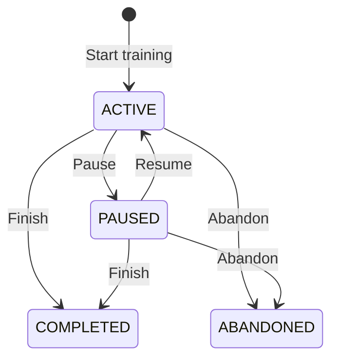

# Training features

## Data contract

Workout weights are kilograms. The owner confirmed this unit before implementation. No stored weight is converted. Body weight uses kilograms; waist measurements use centimetres.

A date is a server-local calendar date. Existing records use local midnight, and this release retains that convention. No time-zone preference or historical date conversion is added. Weeks start on Sunday. For a workout dated October 10, October 10 sessions are not previous sessions, October 11 is excluded, and October 9 can qualify. A backdated October 1 workout cannot use October 9 values. Previous-session reads also exclude dates later than today. Equal dates use descending creation time and ID; sets use ascending order and ID.

## Entry and reports

- Previous-session values are private to the signed-in user. Select an exercise, then explicitly copy one source set's weight and reps into editable fields. Exercise selection never replaces a draft. Saving requires the normal submit action. History edits and deletions take effect on the next read.
- Sets are WORKING or WARMUP. Optional actual RIR accepts 0–10 in half steps. Blank means unknown. Legacy sets remain completed working sets with null RIR. Repetition retains type, but clears actual RIR. Templates do not store actual RIR.
- Performed sets are completed sets in completed workouts. Active, paused, abandoned, and skipped work cannot produce volume, personal records, prior-session values, muscle counts, or consistency. Total volume includes warm-ups. Working volume and personal records exclude warm-ups.
- A training day contains at least one performed set. Same-date sessions count once. Consistency shows 12 Sunday-start weeks and a selected year's activity. An empty open current week retains the preceding streak; a missed closed week breaks it. Dates later than today do not count. No derived counters are stored.
- Exercise history, dashboard summaries, raw aggregate queries, calendar totals, and statistics use the same completion rules. Calendar and workout lists can still display unfinished sessions without counting their planned values.

## Active sessions

Retrospective creation, repetition, and creation from a template remain completed logging workflows. **Start training** is the explicit live workflow. It copies targets from a template or completed workout, without claiming that these values were performed. The default rest duration is 90 seconds; each start accepts 0–3600 seconds.



Targets are snapshots. Template changes do not rewrite session targets. Actual values can be saved without completion. New live sets have `actualsEntered: false` and blank actual-value inputs. Saving or completing sets this flag to true, so valid 0 kg × 1 values remain visible after reload. The flag is independent of completion. Complete submits the current actual values and saves them with completion in one transaction. Completion without actual values is rejected. Finish opens a confirmation showing the skipped-set count when sets remain unfinished. Cancel leaves the session unchanged. The server still requires explicit partial-finish confirmation. Abandon also requires confirmation: recorded data remains, but the session cannot be resumed. Completed and abandoned sessions cannot be reopened.

The server stores state, active duration, the current resume timestamp, and the rest deadline. Rest display uses a wall-clock deadline and survives reloads. Pause and terminal transitions clear the rest deadline. Version checks reject stale edits from another tab. Repeating a confirmed completion or transition is a no-op. Start tokens and user-row transaction locks prevent duplicate starts; scheduled starts also have a unique user/date constraint. Set editors retain unsaved weight, reps, RIR, and notes when another set is saved/completed, the session is paused/resumed, or a progression suggestion is accepted. Expected validation, conflict, incomplete-session, and unavailable-session failures show localized recovery messages; unexpected failures use generic feedback. Load latest session refreshes confirmed state and concurrency metadata without clearing dirty fields. Review before retrying; confirmation dialogs must be canceled and reopened after a conflict to confirm the latest state. Drafts are not persisted across a full reload or navigation.

## Workout history and creation

History labels Active, Paused, Completed, and Abandoned sessions. Non-completed rows show prescribed set count and completed progress, not performed volume. Continue training opens the existing active or paused session without creating a new workout or resuming a paused timer. Repeat is available only for completed workouts. Overview and reports continue to count performed sets in completed workouts only.

New workout opens `/workouts/new`, a focused date/title/notes screen rather than a form below history. Calendar entry points use `/workouts/new?date=YYYY-MM-DD`; missing or invalid prefills default to today. Cancel returns to history without creating a record. Invalid input and failed requests retain entered values, with pending submission protected against duplicate clicks. Successful creation redirects to the new completed logging workout.

## Exercise metadata and muscle reports

The original controlled muscle catalogue contains chest, back, shoulders, arms, core, quadriceps, hamstrings, glutes, and calves. Equipment contains barbell, dumbbell, machine, cable, bodyweight, band, and other. Relations store primary or secondary muscle involvement and equipment tags. Existing exercises stay untagged. No reference catalogue, code, data, image, or media is copied.

Shared metadata can be edited only by its creator or an administrator. The server enforces this rule. Combined muscle/equipment filters do not change workout data. Weekly reports separate primary working-set counts from secondary involvement. Exercises without primary tags appear under Unknown. Compound sets can appear in more than one row; rows are not whole-body totals or recovery estimates.

License review: openGym uses AGPL-3.0; wger uses AGPL-3.0; SparkyFitness's current local license restricts commercial use. This implementation uses original code and a small original catalogue, not their source or assets.

## Progression

Progression is off until the user saves a positive increment for a template exercise. It uses completed earlier sessions of that user's same template and exercise. The most recent completed session must have every prescribed working set, matching order and snapshot targets, performed at the target load with at least the target reps. Warm-ups do not justify an increase. Misses, skipped sets, changed targets, inconsistent loads, and missing evidence disable the suggestion.

The preview states the source date, reason, and kg increment. Acceptance is explicit and changes only the new session's uncompleted working-set targets. The server rereads the source and rule, checks the displayed weight and session version, and locks the source before applying the change. Corrections or deletion invalidate old evidence. Keeping current targets requires no write. Recorded history and template targets are not increased automatically.

## Scheduling

One template can be assigned to each Sunday-first weekday. An edit or removal starts at tomorrow's local midnight. Revisions have half-open effective intervals: `[effectiveFrom, effectiveTo)`. Repeated edits before tomorrow replace only the pending revision. Closed intervals preserve past planned occurrences.

Calendar occurrences are derived, not pre-created workouts. Starting an occurrence saves its date, template link, and title snapshot. Repeated or concurrent starts return the same linked session. Manual workouts never satisfy a scheduled occurrence. A completed linked session with completed sets qualifies; active or paused work is in progress; an abandoned session is labelled Abandoned; an uncompleted past occurrence is missed. New scheduled starts cannot use past dates. Retries can still return an already-started occurrence. Template deletion closes future assignments and nulls links without deleting workouts or title snapshots. Already-started occurrences remain visible after schedule changes.

## Measurements

Measurements are private to their owner, including when another account is an administrator. A date accepts weight, waist, or both. Values must be finite and greater than zero; weight is at most 500 kg and waist is at most 300 cm. Explicitly saving a date replaces that owner's daily values. Clearing a metric does not turn it into zero. Weight and waist use independent charts and an accessible table. The optional target-weight line appears only on the weight chart. Blank clears the goal. Deleting a user cascades their measurements and goal.

## App CSV version 1

`GET /data/export` exports only the signed-in user's workouts. It does not export passwords, sessions, measurements, template definitions, or shared aliases. The local Markdown export and destructive local CSV importer remain separate, unchanged tools; never use that importer as the web path.

The required header order is:

```text
version,workout_key,date,title,workout_notes,state,active_seconds,template_title,order,exercise,weight_kg,reps,set_notes,set_type,rir,completed,target_weight_kg,target_reps
```

- Version is `1`. Each workout has an opaque export key, including separate same-date sessions. Repeated keys must have identical workout fields. Set rows retain order. Empty workouts use a row with all set columns blank.
- States are ACTIVE, PAUSED, COMPLETED, or ABANDONED. Set types are WORKING or WARMUP. Completion is `true` or `false`. RIR and the paired target values can be blank. Numbers use a decimal point and can use scientific notation for small values; weight is 0–2000 kg, reps 1–1000, and set order 1–1000.
- Each non-null text cell starts with one apostrophe, even when the original text already starts with one. Import removes exactly one prefix. Null is an empty cell; an empty string is a single apostrophe. This reversible encoding protects spreadsheet formula text. CSV quoting supports commas, double quotes, newlines, Unicode, CRLF, and a UTF-8 BOM.
- Uploads are at most 5 MiB and 20,000 data rows. Larger exports need separate files containing complete workout groups before import. The UI documents the limits.
- Preview writes nothing and shows counts, row errors, unknown/ambiguous names, and duplicate candidates. Existing names and aliases can match. Unknown names require explicit mapping or creation; new exercises belong to the importer. No shared aliases are changed.
- Confirmation parses and validates the submitted file again. Exercise mappings and duplicates are rechecked inside a transaction. It never deletes or overwrites existing workouts. A failed row or write rolls back the complete batch.
- Canonical fingerprints omit export IDs and include supported workout/set content. An occurrence ordinal preserves multiple identical same-day sessions with separate keys. Fingerprints and batch digests are user-scoped. Exact retries and rekeyed duplicate files skip existing content. Accepted fingerprints remain receipts even if imported records are later corrected.
- Imported numeric actual values are explicit input and set `actualsEntered` to true. CSV version 1 does not transfer this input-entry flag. Imported session states and targets are retained, but no rest deadline or resume timestamp is started. Export/import does not reconnect template IDs or scheduling definitions.

## Migration and recovery

Production uses PostgreSQL; development uses the generated SQLite schema. The canonical migration is `20261011120000_training_roadmap`. Its columns and tables are additive. The additive follow-up migration `20261011161830_session_actuals_entered` adds the actual-entry flag with a true default. Existing values stay visible, including uncompleted 0 kg × 1 values; the migration does not guess whether old values were placeholders. New live starts explicitly use false. PostgreSQL migration SQL must not be executed against SQLite. The test runner derives the SQLite upgrade from a tracked legacy schema fixture and applies it only to a disposable database.

Before an authorized production migration, stop application writes, make a PostgreSQL backup with `pg_dump`, and restore it into a separate disposable database. Verify record counts and legacy weights/reps before running `prisma migrate deploy` against the authorized target. SQLite backups use the database backup API, not a file copy while writes are active. The tests exercise backup restoration, empty upgrades, and upgrades containing legacy data on both providers.

Prefer a forward correction. Do not drop the new columns, reset the database, or use `db:push` to recover production. Rolling back to the old application is unsafe once planned sessions exist: the old readers would treat them as performed. Stop writes and roll forward instead. A full restore discards later writes and requires separate approval.

Import batches link the exact created workouts through `importBatchId`. For an explicitly approved batch recovery, inspect only rows with that batch ID and owner; compare their current canonical fingerprint with the accepted receipt before deletion. Modified rows require review. Never delete by date. No recovery command or production deployment runs as part of this PR.

## Verification

- `npm run test:training`: pure rules, boundaries, input validation, eligibility, CSV quoting/limits, formula-safe round trips, and canonical fingerprints.
- `npm run test:training:sqlite`: disposable legacy/empty upgrades, backup restoration, ownership, starts/retries, correction, snapshots, timer transitions, scheduling concurrency, measurements, atomic imports, and round trips.
- `npm run test:training:postgres`: the same integration suite and recovery checks in a uniquely named temporary PostgreSQL container. The container is removed afterward.
- `node --import tsx --test tests/form-outcome.test.ts`: expected serializable session failure codes, validation mapping, success, and unexpected-exception propagation.
- `npm run test:ui`: includes the UX regression suite for cross-set draft retention, current concurrency metadata, conflict recovery, clearing actuals, state-aware history, confirmation cancellation/pending/failure recovery, focused creation, date prefills, locales, and accessibility at 390/768/1440px; existing regressions plus the nine-feature browser workflow, invalid/stale draft retention, explicit partial finish, stale progression evidence, schedule removal, metadata permissions, measurement edits/deletion, duplicate and unknown imports, keyboard access, mobile overflow, and axe checks.
- `npm run test:ui:production`: browser workflows against the production build and a separate temporary PostgreSQL container.
- `npm run check`, `npm run build`, and `prek run -a`: repository gates.

Browser tests use `http://localhost:8784`, the current isolated development/test port. The older plans' port 8783 belongs to production. Test runners refuse to reuse a running server and stop their server afterward. Production services, developer databases, and personal `data/` files are not used.
